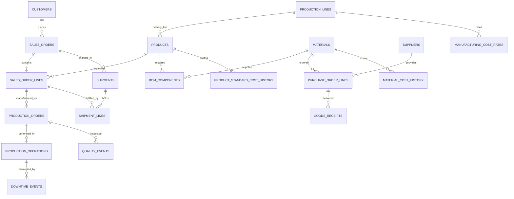

# Logical data model — source version 1.0.0

The physical PostgreSQL schema in `sql/setup/00_create_schema.sql` is the executable contract. The diagram shows only essential business joins, not a prescribed Power BI star schema.

`inventory_transactions` references a material **or** finished product and carries an explicit source reference to a receipt, production order, or shipment line, depending on movement type. Its sources are constrained with foreign keys, but the type-dependent business rules are also verified by `validate.py`. The `raw_import` schema is deliberately not forced into referentially perfect behavior.

## Time semantics

- `requested_date`: what the customer requested.
- `promised_date`: what was committed at order-line level (candidate for on-time metrics; formal KPI definition is pending).
- `planned_start_date` / `planned_end_date`: manufacturing plan, not actual execution.
- `actual_start_date` / `actual_completion_date`: observed execution; completion is NULL for open production orders.
- `confirmed_date`: supplier commitment, not actual receipt.
- `ship_date`: departure/dispatch from warehouse, **not confirmed customer arrival**. The simulation does not model last-mile delivery or proof of receipt. A report called On-Time Delivery must state this operational proxy limitation if it uses shipping date.
- All business dates are represented as **calendar dates**, without time-of-day and time-zone detail.
- `effective_from` is inclusive; `effective_to` is exclusive, with NULL meaning open ended.

## Design boundaries

The source model is deliberately relational and normalized; it is not yet a Power BI dimensional model. Avoid simultaneously connecting several one-to-many fact relationships as bidirectional filters without careful modeling. Exact KPI formulas and cost allocation methodology will be agreed through tickets rather than embedded as ready-made analyst solutions.
